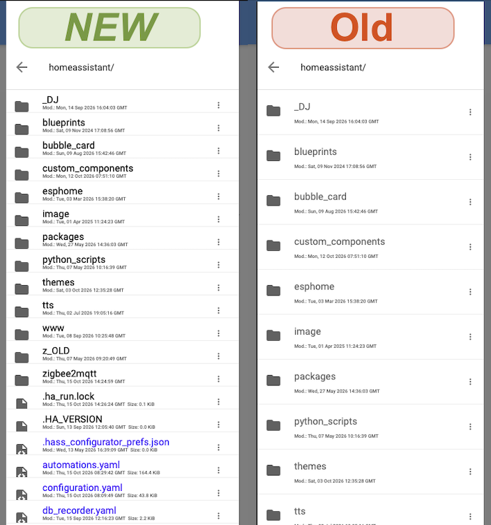

# Home Assistant File editor customization

It updates the "File editor" app CSS to make the file/folder list way easier to read and use.

- Reduces spacing in the File Editor sidebar (file/folder rows) so you most likely don't have to scroll
- Colors filenames (.yaml, .json, .sh) **blue**.
- Adds/updates the changes to File Editor's installed `style.css`, between `BEGIN_CUSTOM_OVERRIDES` and `END_CUSTOM_OVERRIDES` markers.




Because this is a patch, these modifications are removed after each:

- UPDATE of the File editor app
- RESTART of the app (manual pressed restart or changed config and therefore restart)
- REBOOT of physical HA server (note, I hardly ever reBOOT but mostly use reSTART)
    
With method 2b the mods are done quite fast (30 seconds)


## WHAT does the code do? 
Inside the "File editor" app docker container

1. CHECK if the style.css was modified
   YES= remove modifications
   
2. MODIFY css file


## REQUIREMENTS
- "Advanced SSH & Web Terminal" App (from HA App store) + "protected mode" (temporarily) disabled to update the File editor css file.
- "File editor" (from HA App store)


## STEP 1 add script

1. SSH to HA or "Open the Web UI" from the "Advanced SSH & Web Terminal" app page

2. COPY FILE `ha-file-editor-mod.sh` to `/config/` OR create the file yourself and paste the contents of the file in this repo.

3. SAVE file

4. `chmod +x ha-file-editor-mod.sh`


Now you have 2 choices, 2a or 2b

## STEP 2a run script (slower)

1. GOTO the "Advanced SSH & Web Terminal" App [page](http://homeassistant.local:8123/config/app/a0d7b954_ssh/info).

2. TURN OFF "Protection mode" + RESTART "Advanced SSH & Web Terminal" app

3. SSH to HA or "Open the Web UI" from the app page

4. RUN:  `./config/ha-file-editor-mod.sh`

5. TURN ON "Protection mode" + RESTART "Advanced SSH & Web Terminal" app


## STEP 2b run script (faster)

From a workflow perspective it is faster by adding this script to the "Advanced SSH & Web Terminal" app _init_commands_ section.

add to init_commands:   `sh /config/ha-file-editor-mod.sh`

That way, every time the "Advanced SSH" app (re)starts this command will be executed. 
HOWEVER, this only works with Protection mode disabled. So IF you add this line to the init_commands the flow will be:

1. GO TO the "Advanced SSH & Web Terminal" App [page](http://homeassistant.local:8123/config/app/a0d7b954_ssh/info).

2. TURN OFF "Protection mode" + RESTART "Advanced SSH & Web Terminal" app

    (now the changes have been made)

3. TURN ON "Protection mode" + RESTART "Advanced SSH & Web Terminal" app

Now it had at least one "startup" run with protection mode disabled and the script executed fine.


## RESTORE original CSS

The first run creates a backup at `style.css.bak` inside the File Editor container, if one does not already exist.

While protected mode is disabled in Advanced SSH & Web Terminal, run:

```sh
CONTAINER=$(docker ps --format '{{.Names}}' | grep core_configurator | head -n 1)

docker exec "$CONTAINER" /bin/sh -c '
  CSS="/usr/lib/python3.14/site-packages/hass_configurator/style.css"
  if [ -f "$CSS.bak" ]; then
    cp "$CSS.bak" "$CSS"
  else
    echo "Backup not found: $CSS.bak" >&2
    exit 1
  fi
'
```
(this finds the right docker container ID and then copies the .bak file over the modified file)


## Troubleshooting

| Symptom | What to check |
| --- | --- |
| `docker: not found` | You are likely running in Home Assistant Core instead of the Advanced SSH add-on, or Docker is unavailable in that shell. |
| Cannot access Docker | Check that Protection Mode is disabled and the SSH add-on was restarted. |
| Empty or incorrect container name | Confirm File Editor is running: `docker ps --format '{{.Names}}' \| grep core_configurator` |
| `style.css` not found | The File Editor package path may have changed after an update. |
| Styling unchanged | Hard-refresh the File Editor tab (SHIFT/RELOAD page) |
| Patch disappeared after settings change | The File Editor container have been recreated. Run the patch again. |


## FYI

This is an **unofficial customization**, not a supported File Editor configuration option. Future versions may change the CSS selectors, icon classes, or installation path. I will then try to update the code so it continues to work


## TIP

To make the file list more compact, in the File Editor configuration add the following folder exclusions (examples)

- .cache
- .ssh
- .cloud
- .storage (because you have to know what you do when editing files in this folder)
- __pycache__
- home-assistant.log.fault

